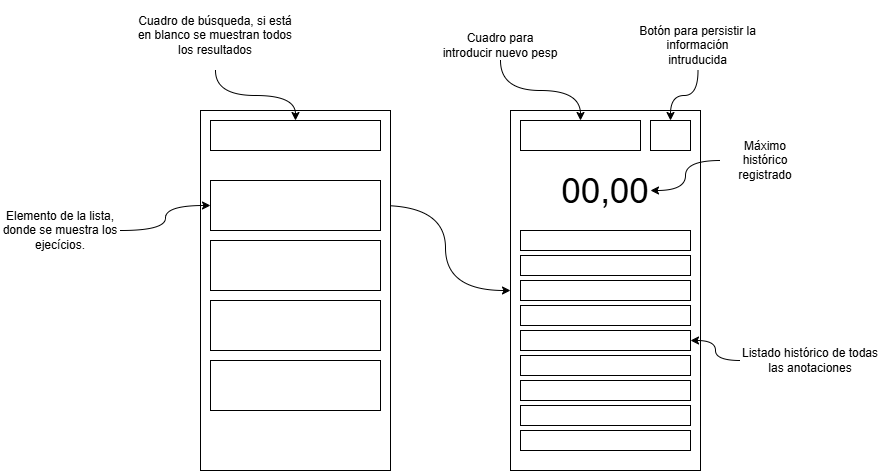
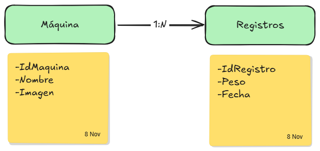

En esta aplicación, se busca crear una herramienta para registrar los pesos utilizados en cada ejercicio durante una rutina en el gimnasio.

### Funcionalidades principales

- Poder leer los registros de una base de datos
- Poder crear y persistir nuevos datos
- Poder filtrar por nombre

### Fases del proyecto y que se espera

1. (Maquetación) Crear un diagrama con las pantallas señalando los elementos interactivos y que se espera que hagan.
2. (Desarrollo) Desarrollar e implementar las funcionalidades imprescindibles para que la aplicación cumpla su cometido.
3. (Diseño) Definir de manera escueta la interfaz de usuario para que sea más fácil de usar y de entender.
4. (Testeo) Definición de tests.

### 1. Maquetación

La aplicación se va a componer en 2 pantallas, el listado de todos los ejercicios de los cuales se disponga de información, y el detalle de las mismas, donde se podrá crear y listar nuevos apuntes acerca del ejercicio, como el peso y las repeticiones.

### 2. Desarrollo

El desarrollo se subirá en GitHub https://github.com/VicenteMon/BasicGymNotes.git. A continuación se desarrolla con ha ido el proceso de desarrollo por días y tareas.

- [ ]  Implementación de Room
- [ ]  Implementación Navigation3
- [ ]  Crear componente de la lista principal (ejercicios/máquinas)
- [ ]  Crear componente de búsqueda
- [ ]  Crear vista principal
- [ ]  Crear componente para crear registros
- [ ]  Crear botón para persistir los datos
- [ ]  Crear componente para listar las anotaciones creadas

### 2.1 Diseño de la base de datos

Para la primera versión de esta aplicación solo se va a necesitar dos tablas. Una para registrar las máquinas que van a componer la aplicación, y otra para los registros creados por el usuario, con una relación entre ellas de Uno a Muchos (1:N).

#### Links importantes:

Room: https://developer.android.com/training/data-storage/room?hl=es-419